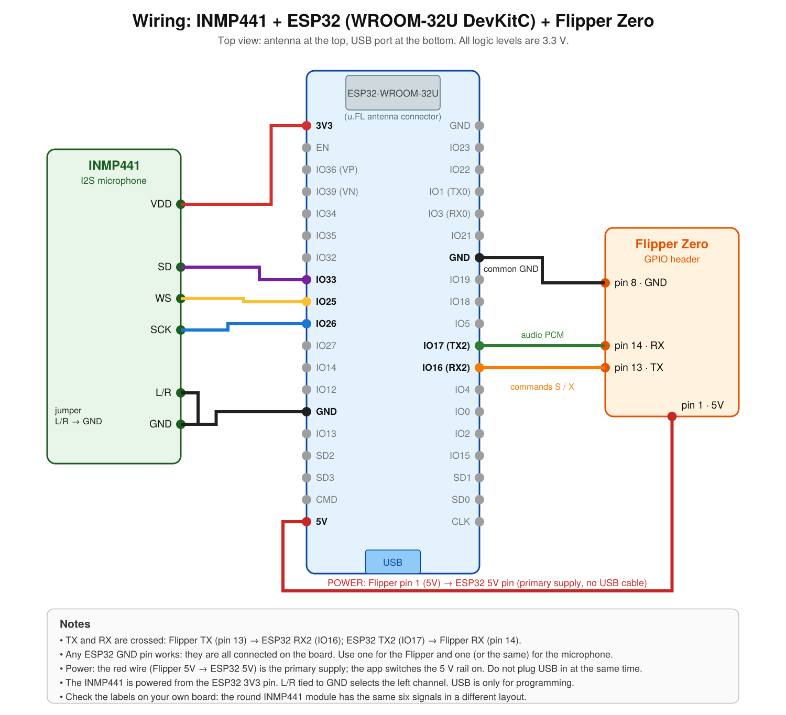

# Flipper Zero Mic Recorder

Record audio from an **INMP441 I2S microphone** to the **Flipper Zero's SD card**, using an **ESP32** as an I2S-to-UART bridge.

The Flipper Zero has no I2S input on its GPIO header, so the microphone is read by an ESP32 ( for this project an ESP32-WROOM-32U has been used ), which streams raw audio to the Flipper over UART. The Flipper app saves the stream as a standard WAV file.

```
INMP441 --I2S--> ESP32 --UART 921600 baud--> Flipper Zero --> /ext/audio_rec/rec_YYYYMMDD_HHMMSS.wav
                  ^                              |
                  |                              |
                  +------ commands 'S' / 'X' ----+
```

- Audio format: WAV, PCM, **16 kHz, 16-bit, mono** (32 KB/s, about 1.9 MB per minute)
- Start/stop with one button, live level meter, adjustable gain (-12 ... +12 dB)
- Checks at startup that the ESP32 and the microphone are really connected, and closes itself with an error message if not
- The ESP32 is powered from the Flipper's 5 V pin (pin 1): the app switches the 5 V rail on while it runs
- Includes a breadboard wiring diagram

> **Responsible use:** recording people without their knowledge or consent is illegal in many places. Use this project only where you are allowed to record.

## Repository layout

| Path | Content |
|---|---|
| `flipper_app/` | Flipper Zero app (`.fap`) source: `mic_recorder.c`, `application.fam`, `mic_icon.png` |
| `esp32/esp32_inmp441_streamer/` | Arduino sketch for the ESP32 |
| `docs/` | Wiring diagram, serial protocol, troubleshooting |

## What you need

- Flipper Zero (tested on **Momentum** firmware)
- ESP32 board with a free UART, e.g. an ESP32-DevKitC with an ESP32-WROOM-32U or WROOM-32
- INMP441 I2S microphone module


## 1. Wiring



| INMP441 | ESP32 | Notes |
|---|---|---|
| VDD | 3V3 | 3.3 V only |
| GND | GND | any ESP32 GND pin |
| SCK | GPIO26 | bit clock (BCLK) |
| WS | GPIO25 | word select (LRCLK) |
| SD | GPIO33 | data |
| L/R | GND | left channel (the sketch reads the left slot) |

| Flipper Zero | ESP32 | Notes |
|---|---|---|
| pin 13 (TX) | GPIO16 (RX2) | commands |
| pin 14 (RX) | GPIO17 (TX2) | audio |
| pin 8, 11 or 18 (GND) | GND | **required**; any ESP32 GND pin (they are all connected on the board) |
| pin 1 (5V) | 5V / VIN | **power supply**, see "Power" |

TX and RX are crossed on purpose: the Flipper's TX goes to the ESP32's RX and vice versa.

### Power

- **Primary supply (`POWER_ESP32_FROM_FLIPPER 1`, the default):** the app switches on the 5 V rail on Flipper pin 1 while it runs and switches it off when it exits. Connect pin 1 to the ESP32's 5V/VIN pin and **unplug the ESP32's USB cable**. Never join two 5 V sources.
- **Alternative, USB-powered ESP32:** set `POWER_ESP32_FROM_FLIPPER 0` in `flipper_app/mic_recorder.c` and rebuild. Only TX, RX and GND are then needed between the two devices.

If your ESP32 is a bare module (not a dev board) you need a USB-serial adapter to program it, a stable 3.3 V supply, EN pulled high, and GPIO0 pulled low only while flashing.

## 2. ESP32 sketch

1. Arduino IDE -> Boards Manager -> install **esp32 by Espressif, version 3.x**.
2. Select the board **ESP32 Dev Module**.
3. Open `esp32/esp32_inmp441_streamer/esp32_inmp441_streamer.ino` and upload it.
4. Open the Serial Monitor at 115200 baud. You should see `Microphone check: range=... -> OK` and `Ready. Waiting for command 'S' from the Flipper.`
   If the I2S driver fails to start, the onboard LED (GPIO2) blinks fast.

`GAIN` (default `2.0`) sets the gain applied inside the ESP32. The Flipper app adds -12 ... +12 dB on top of it. A lower sketch gain leaves more headroom before clipping, which can only be corrected at the source.

## 3. Flipper app

Requires [ufbt](https://github.com/flipperdevices/flipperzero-ufbt) and an SDK that matches the firmware running on your Flipper.

```
pip install ufbt
cd flipper_app
ufbt                # builds dist/mic_recorder.fap
ufbt launch         # builds, installs and starts it on the Flipper connected over USB
```

You can also copy `dist/mic_recorder.fap` to `apps/GPIO/` on the SD card. The app appears under **Apps -> GPIO -> Mic Recorder**.

## Using the app

At startup the app makes a short test recording (nothing is saved) to check the setup:

| Screen | Meaning |
|---|---|
| `Looking for device...` | test in progress |
| `ESP32 not detected.` | no data arrives on the UART: check wiring, power, sketch |
| `Microphone not detected.` | data arrives but the signal is flat: check the microphone wiring |
| `Ready` | all good |

On an error screen the app closes by itself after 5 seconds (Back closes it immediately).

| Button | Action |
|---|---|
| OK | start / stop recording |
| Up / Down | gain +3 dB / -3 dB (range -12 ... +12 dB, works during recording too) |
| Back | stop and save if recording, otherwise exit |

While recording, the screen shows the elapsed time, size, file name and `Lvl:<n> Gain:<dB>`. `Lvl` is the peak sample amplitude (0 ... 32767) of the last quarter second, **after** the gain: `0` means silence, values near 32767 mean clipping. If `Lost:` or `UARTerr:` appears, bytes were dropped on the link.

Recordings are saved as `/ext/audio_rec/rec_YYYYMMDD_HHMMSS.wav` (the time comes from the Flipper's clock).

## Configuration

At the top of `flipper_app/mic_recorder.c`:

| Define | Default | Meaning |
|---|---|---|
| `POWER_ESP32_FROM_FLIPPER` | `1` | switch on 5 V on pin 1 while the app runs |
| `STARTUP_CHECK` | `1` | check ESP32 + microphone at startup (`0` skips it) |
| `DETECT_MIN_RANGE` | `3` | minimum peak-to-peak of the test signal for "microphone present" |
| `NOT_FOUND_CLOSE_MS` | `5000` | how long the error is shown before the app closes |
| `GAIN_DEFAULT_IDX` | `4` | start gain (index into the table, `4` = 0 dB) |

`SAMPLE_RATE` and `SERIAL_BAUD` must match the sketch (`SAMPLE_RATE`, `UART_BAUD`) if you change them.

## How it works

- The ESP32 reads the INMP441 with the I2S peripheral (32-bit slots, left channel, 16 kHz), removes the DC offset, applies the gain and converts to 16-bit samples.
- Streaming starts when the Flipper sends `S` and stops on `X` (see `docs/PROTOCOL.md`).
- The app receives the bytes in a UART callback into a 16 KB stream buffer; a worker thread applies the app-side gain and writes the WAV file, patching the header with the final length at the end.
- The startup check is a short, discarded test recording: no data means no ESP32, a flat signal means no microphone.

## Troubleshooting

See `docs/TROUBLESHOOTING.md` (build errors, USB under WSL, silent audio, ...).

## Limitations

- Sample rate is fixed at 16 kHz in both programs. Changing it means editing both and reflashing.
- There is no checksum on the UART link; the `Lost:` / `UARTerr:` counters are the only indication of corruption.
- A "microphone not detected" result means a flat signal; a microphone wired to the wrong channel (silence) is reported the same way.
- Tested by the author on a single setup (Flipper Zero with Momentum firmware, ESP32-DevKitC-32U, INMP441). Other combinations may need small changes.

## License

MIT, see `LICENSE`.

